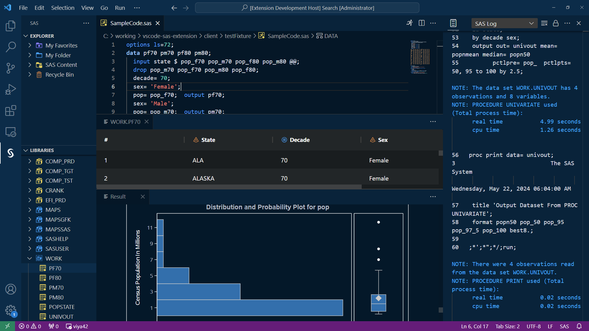

# SAS Extension for Visual Studio Code

[Capabilities](https://sassoftware.github.io/vscode-sas-extension/matrix) | [Installation](https://sassoftware.github.io/vscode-sas-extension/installation) | [Configuration](https://sassoftware.github.io/vscode-sas-extension/Configurations/) | [Features](https://sassoftware.github.io/vscode-sas-extension/Features/) | [FAQ](https://sassoftware.github.io/vscode-sas-extension/faq)

Welcome to the SAS Extension for Visual Studio Code! The SAS extension is lightweight, runs anywhere, and allows you to integrate SAS with other languages. You can connect directly to SAS Viya and SAS 9 and run code.

Before you can run SAS code, you must [configure the SAS extension](https://sassoftware.github.io/vscode-sas-extension/Configurations/) to access your SAS 9.4 (remote or local) server or a SAS Viya server and [add a connection profile](https://sassoftware.github.io/vscode-sas-extension/Configurations/Profiles/).

The SAS extension includes many [features](https://sassoftware.github.io/vscode-sas-extension/Features/) to help you access your data, write and run code, and create SAS notebooks.

- SAS syntax highlighting and help, code completion, and code snippets
- Navigate SAS Content and libraries, including table viewer
- Create notebooks for SAS, SQL, Python, R, and other languages

## Find All References and Rename Symbol

For SAS files, Find All References and Rename Symbol support DATA step variables, datasets, macro variables, macro parameters, and macro programs. Results and rename edits are limited to the active SAS file. DATA step variables are scoped to their DATA step, and datasets are distinguished by library reference and member name. Statically recognizable names in macro constructs such as `%SYMDEL`, `%SYSLPUT`, `%SYSRPUT`, `%SYSEXIST`, `%SYMGLOBAL`, `%SYMLOCAL`, `%SYSMACDELETE`, `%SYSMACEXEC`, and `%SYSMACEXIST` are supported. Dynamically computed names and runtime macro resolution are not evaluated.



## DATA Step Debugger (Experimental)

In desktop VS Code, select a SAS Viya connection profile, place the cursor
inside a DATA step in a SAS file, and run **SAS: Debug DATA Step** from the
Command Palette or the SAS editor's right-click menu. The debugger submits only that DATA step, including unsaved
edits. It opens a separate copy in a new SAS editor tab named **DATA Step
Debugger** and highlights debugger locations in that copy, leaving the
original document untouched. The copy is closed without saving when the
debugger stops.

To choose a different file, use a launch configuration:

```json
{
  "type": "sas",
  "request": "launch",
  "name": "Debug SAS DATA Step",
  "program": "${workspaceFolder}/example.sas"
}
```

`program` accepts a file path or document URI; omit it to use the active editor.
Place the cursor in the DATA step of the specified file, or set `position` to a
zero-based `{ "line": 0, "character": 0 }` position inside that step.
The extension adds the debugger options and initial `describe _all_;` and
`examine _all_;` commands without modifying the source document. The code runs
on your Viya session and can modify data. **Step Over** and **Step Into** both
submit `step;` to advance one DATA step statement. **Continue** submits `go;`
to resume execution. Verified breakpoints are not implemented yet.

While paused, setting a breakpoint submits `break <lineNumber>;` and displays
the command's log without advancing execution. Breakpoint verification and
removal on the SAS server are not implemented yet.

After each debugger Compute job finishes, its complete log is fetched,
including all paginated log entries. Automatic `describe _all_;` and
`examine _all_;` commands marked with `/*hideInLog*/` and their responses are
hidden in the Debug Console but still used to update variables. Errors and
warnings remain visible. Logs are not streamed while a job is running.

The log is then parsed, and the debugger pauses at the last statement where SAS
stopped. The **Variables** view shows the values `examine` reported at that
stop, with types and lengths from `describe`, and SAS automatic variables such
as `_N_` and `_ERROR_` are listed under **Automatic Variables**. If the stop
cannot be matched to a line in the document, it is shown without a source
location.

## Support

### FAQs

Please check the [FAQ](https://sassoftware.github.io/vscode-sas-extension/faq) page for some common questions.

### SAS Programming Documentation

[SAS Programming documentation](https://go.documentation.sas.com/doc/en/pgmsascdc/v_048/lepg/titlepage.htm)

### SAS Communities

For usage questions, tips, and workarounds, interact with other SAS users to ask questions and get answers on the [SAS Programmers Community site](https://communities.sas.com/t5/SAS-Programming/bd-p/programming).

### SAS Technical Support

SAS Technical Support provides standard support for the current release of the [SAS Extension for Visual Studio Code](https://marketplace.visualstudio.com/items?itemName=SAS.sas-lsp) available through the [Visual Studio Marketplace](https://marketplace.visualstudio.com/items), in accordance with the [Policies for All SAS Products | SAS Support](https://support.sas.com/en/technical-support/services-policies/policies-for-sas-products.html). If you have been unable to solve a problem or find answers using self‑help resources, open a case in the [Customer Service Portal](https://service.sas.com/csm) to get technical support for the SAS Extension for VS Code.

### Reporting Issues

Submit a [GitHub issue](https://github.com/sassoftware/vscode-sas-extension/issues) for tracking bugs, feature requests, or questions regarding open‑source contributions.

## Contributing to the SAS Extension

We welcome your contributions! Please read [CONTRIBUTING.md](/CONTRIBUTING.md) for details on how to submit contributions to this project.

## License

This project is subject to the Apache License Version 2.0, a copy of which is included as [LICENSE](LICENSE)
