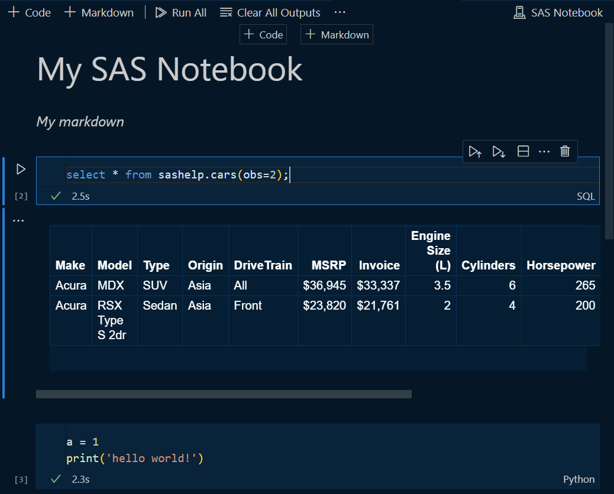

# SAS Notebook

SAS Notebook is an interactive notebook file that includes markdown code, executable code snippets, and corresponding rich output cells.

- To create a SAS notebook, select `File > New File > SAS Notebook`.
- To change a code language, click the `Select Cell Language Mode` button in the lower right corner of a code cell.
- To toggle log or ODS output display, click the **More Actions** (`...`) button in the upper left corner of the output and select `Change Presentation`.
- You can use the `File` menu to save your SAS Notebook to a `.sasnb` file, share the notebook with others, and open the notebook in another VS Code window.



:::note

Starting with Visual Studio Code version 1.93, [the language for SQL files has been renamed](https://code.visualstudio.com/updates/v1_93#_renamed-sql-to-ms-sql) from 'SQL' to 'MS SQL'. As a result, the SQL cell in SAS Notebook is now labeled 'MS SQL'. The SAS Extension for Visual Studio Code does not control the label of the SQL cell in SAS Notebook. The functionality of the SQL cell has not changed, however. Valid PROC SQL code continues to work in the MS SQL cell.

:::

## Python notebook output

By default, Python notebook cells display the raw output produced during execution, including SAS log content. Enable `SAS.notebook.cleanOutput` to provide a cleaner notebook experience for Python cells.

When enabled:

- SAS log boilerplate is filtered from notebook output.
- Python exceptions are displayed as notebook errors.
- The final Python expression is automatically displayed without requiring a `print()` statement.
- ODS and graphical output generated through `SAS.show()` and related APIs remain available.

The setting is disabled by default. You can enable it from VS Code Settings by selecting:

`SAS > Notebook: Clean Output`

or by updating your `settings.json`:

```json
{
  "SAS.notebook.cleanOutput": true
}
```

### Automatic display of final expressions

When clean output is enabled, the final Python expression in a notebook cell is automatically displayed.

For example:

```python
values = [1, 2, 3]
values
```

produces:

```text
[1, 2, 3]
```

without requiring:

```python
print(values)
```

The final expression is displayed using its Python text representation. A final expression that evaluates to `None` is not displayed.

Assignments and other statements are not automatically displayed:

```python
x = 10
```

### Notes

- The setting affects Python notebook cells only.
- If expression analysis cannot be completed, execution falls back to normal notebook behavior.

## Export

To export your SAS Notebook to other formats, click the **More Actions** (`...`) button on the notebook toolbar at top, and select `Export`. The following formats are supported.

### SAS

PYTHON, R, and SQL code cells will be wrapped with PROC PYTHON/R/SQL respectively to be executed on SAS. Markdown cells will be converted to block comments.

### HTML

The exported HTML will be in Light or Dark theme depending on your VS Code theme kind.

By default it doesn't include SAS log into the exported HTML file. To include log, check the `SAS.notebook.export.includeLog` setting.
